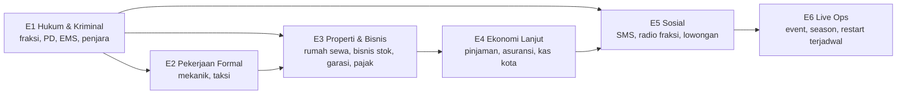

# 20 — Rencana Induk Fase E (Hukum, Fraksi, Properti, Ekonomi Lanjut)

Dokumen ini menjawab satu pertanyaan: **setelah bensin/bengkel, objektif pemain
baru, radio, dan arena tembak — apa yang paling menaikkan kualitas server, dan
dalam urutan apa?**

Semua angka di sini diambil dari kode dan database yang ada sekarang, bukan
perkiraan. Kalau ada baris di dokumen ini yang berbeda dengan kode, kode yang
benar dan dokumen ini harus diperbaiki.

---

## 0. Status nyata hari ini

| Ukuran | Nilai |
|---|---|
| Baris Pawn | 14.701 |
| Tabel DB | 17: `accounts`, `characters`, `character_items`, `identity_docs`, `plates`, `money_log`, `locations`, `warungs`, `warung_items`, `buildings`, `vehicles`, `vehicle_catalog`, `rental_packages`, `rental_sites`, `radio_stations`, `range_scores`, `admin_audit` |
| Perintah | 66 |
| Dialog | 20 |
| Aksi lokasi | 11 (`ATM`, `LOKET_PD`, `JOB_CENTER`, `WARUNG`, `GEDUNG`, `RS`, `RENTAL`, `DEALER`, `BENSIN`, `BENGKEL`, `LATIHAN`) |
| Sudah jalan | auth PIN + kunci superadmin, 3 slot karakter, identitas KTP/SIM/plat, bank (setor/tarik/transfer), warung 2 blueprint, properti + gedung + interior unik, survival (lapar/haus/energi), inventori grid, kurir, rental 3 paket, kendaraan pribadi + STNK + dealer, bensin + bengkel, radio 4 stasiun, arena tembak, objektif 5 langkah |
| Belum ada | fraksi/PD/EMS, penjara, MDC, rumah sewa, bisnis + stok, mekanik/taksi, SMS/kontak, marketplace, pinjaman, asuransi, pajak aktif, event tools, restart terjadwal |

Tiga hal yang **sudah disiapkan tapi belum dipakai** — ini penting, karena berarti
fondasinya sudah ada dan tinggal diisi:

| Sudah ada | Dipakai di |
|---|---|
| `MONEY_REASON_SALARY` | belum dipakai sama sekali |
| `MONEY_REASON_SALARY_FACTION` | belum dipakai sama sekali |
| `MONEY_REASON_HOSPITAL` | belum dipakai sama sekali |
| `MONEY_REASON_FINE` | hanya `tilang.pwn` |
| `MONEY_REASON_TAX` | hanya `identity.pwn` |
| Aksi lokasi `LOKET_PD` | prompt ada, isinya belum ada |
| Aksi lokasi `RS` | prompt ada, isinya belum ada |

---

## 1. Diagnosis ekonomi (angka nyata)

### Pemasukan

| Sumber | Rp | Frekuensi wajar | Rp/jam |
|---|---|---|---|
| Kurir | 5.000 | 1 antar per 2–3 menit | 100.000 – 150.000 |
| Warung pemain | margin item | tergantung ramai | 0 – 150.000 |
| Jual barang (belum ada) | – | – | – |

### Pengeluaran

| Penguras | Rp | Frekuensi wajib | Rp/jam |
|---|---|---|---|
| Makan | 5.000 (+45 lapar) | lapar 100 poin = 11.100 | ± 7.400 |
| Minum | 3.000 (+55 haus) | haus 100 poin = 5.450 | ± 5.450 |
| Bensin | 200/liter, tangki 50 L = 10.000 | ± 45 menit mengemudi | ± 13.300 |
| Servis | 500 + kerusakan × 20 | saat rusak | 0 – 5.000 |
| Rental | 5.000/5 menit (Faggio) | sementara | 60.000 |
| Latihan tembak | 2.500 – 6.000 / 90 detik | opsional | 2.000 – 12.000 |

**Kesimpulan diagnosis:**

1. Penguras **sudah ada**, tapi hampir semuanya **bisa dihindari** dengan berhenti
   berkendara, berhenti makan, atau tidak latihan. Tidak ada biaya yang menagih
   sendiri.
2. Rasio pemasukan tertinggi (kurir ±120 rb/jam) terhadap kewajiban (makan+minum
   ±13 rb/jam + bensin ±13 rb/jam) sekitar **9 : 1**. Artinya pemain rajin dalam
   satu jam bisa membeli mobil pertama di hari yang sama, lalu tidak punya alasan
   memakai uangnya lagi.
3. Yang hilang bukan "penguras baru", tapi **kewajiban berkala** (pajak, asuransi,
   gaji) dan **risiko kehilangan** (ditangkap, kendaraan hilang, rumah sakit).
   Keduanya lahir dari sistem yang belum ada: hukum & fraksi, dan properti.

Karena itu urutan fase di bawah **tidak dimulai dari menambah pekerjaan**, justru
sebaliknya.

---

## 2. Aturan yang dikunci untuk semua fase

Berlaku untuk setiap modul baru, tanpa terkecuali:

1. **Satu modul satu pemilik state**, dan modul itu yang menggambar HUD-nya sendiri.
2. **Uang hanya lewat `src/shared/money.pwn`.** Tidak ada `Money_*` lain di modul
   domain. Setiap aliran wajib punya `MONEY_REASON_*`; kalau belum ada, tambahkan.
3. **Data-driven**: tabel dimiliki modul, dibuat di `Xxx_Boot()`, seed **hanya bila
   tabel kosong** (edit admin tidak boleh tertimpa saat restart).
4. **Interaksi manual**: pickup hanya penanda visual; aksi hanya lewat prompt `[Y]`;
   prompt **tidak** memanggil `SelectTextDraw`.
5. **Validasi server-side untuk semua aksi sensitif**: jarak, fase pemain, status
   duty, kepemilikan, kecukupan uang. Klien hanya mengirim niat, bukan hasil.
6. **File ≤ 400 baris.** Split hanya di batas blok, akses lintas file lewat
   accessor `stock`. Timer wajib `forward` di `timer.pwn` + didaftarkan di
   `Timer_Boot()`.
7. **Wiring gate wajib lulus**: perintah dirutekan di `callbacks.pwn`, masuk `/help`,
   dialog terdaftar di `Dialog_IsKnown`, aksi lokasi punya ikon.
8. **Setiap fitur yang memberi uang wajib berpasangan dengan penguras** di fase yang
   sama. Ini bukan saran, ini syarat merge.

---

## 3. Peta fase



Alasan urutan: **E1 dulu** karena satu-satunya sistem yang menghasilkan cerita
antar pemain, sekaligus penguras terbesar (denda, jaminan, rumah sakit) dan syarat
agar penjara/rumah sakit punya arti. **E3 tidak boleh didahulukan** karena
properti di atas ekonomi yang bocor hanya akan mempercepat inflasi.

---

## 4. E1 — Hukum & Kriminal (± 1.460 baris, 2 minggu)

Tujuan pemain: *"kalau saya jahat, ada yang mengejar saya; kalau saya ditangkap,
saya kehilangan waktu dan uang."*

### 4.1 Modul

| File | Baris | Isi |
|---|---|---|
| `src/domain/faction/faction_data.pwn` | 150 | tabel `factions`, seed 3, cache + reload |
| `src/domain/faction/faction.pwn` | 300 | `faction_members`, `/duty`, `/frak`, armory, gaji |
| `src/domain/law/wanted.pwn` | 250 | tabel `wanted`, tambah/turun poin, expiry |
| `src/domain/law/jail.pwn` | 240 | tabel `jail_sentences`, blueprint penjara, `/tahan` `/bebas` |
| `src/domain/law/police.pwn` | 300 | `/m`, `/borgol`, `/geledah`, `/cari`, MDC textdraw |
| `src/domain/law/police_admin.pwn` | 200 | `/buatpd`, `/setpangkat`, `/armory add` |
| `src/domain/ems/ems.pwn` | 220 | `/obat`, revive, tagihan RS, `/rs` |

### 4.2 Database

```sql
factions (faction_id PK, code UNIQUE, name, type, salary, color, enabled)
faction_members (character_id PK, faction_id, rank 1..5, duty, joined_at,
                 Index(faction_id))
wanted (character_id PK, points 0..100, reason, officer_id, updated_at,
        expires_at, Index(expires_at))
arrests (arrest_id PK, character_id, officer_id, points, fine, jail_minutes, created_at)
jail_sentences (character_id PK, minutes, fine_paid, release_at, reason)
hospital_bills (bill_id PK, character_id, amount, paid, created_at)
```

### 4.3 Mekanik rinci

**Wanted points** (0–100, satu nilai per karakter):

| Aksi | Poin |
|---|---|
| Menyerang warga | +5 |
| Menembak warga | +15 |
| Menabrak lalu kabur | +10 |
| Membawa senjata ilegal (di luar arena) | +25 |
| Menembak petugas | +40 |
| Titik hilang otomatis | −2 per 5 menit tanpa aksi |

Ambang wewenang PD:

| Poin | Boleh dilakukan |
|---|---|
| ≥ 20 | `/cari` (muncul di MDC) |
| ≥ 40 | `/borgol` + `/geledah` |
| ≥ 60 | tembak diperbolehkan (aturan RP, bukan mekanik) |

**Denda & penjara** (uang keluar nyata, bukan hiasan):

```
denda      = points × 250                    (maks Rp 25.000)
penjara    = max(1, points / 10) menit       (maks 20 menit)
jaminan    = denda × 2                        (boleh selama penjara)
```

Pemain yang tidak punya uang tetap dipenjara; denda memakai `Money_Debt()`, satu-satunya
API yang boleh membuat saldo minus (catatan: dipakai hanya untuk denda yang tidak bisa
dihindari). Ini yang membuat `LOKET_PD` akhirnya berfungsi.

**Penjara**: blueprint 4 di `interiors.pwn` (sel 4×4 m + lorong). Waktu rilis
disimpan sebagai `release_at` (epoch), **bukan timer**: relog, crash, atau restart
server tidak membebaskan pemain. Tick 5 detik hanya untuk memeriksa rilis.

**Armory fraksi** (`/armory`): senjata diberikan hanya saat `duty = 1`, dicabut
saat `/duty off`, mati, atau disconnect — pola pencabutan 4 jalur yang sudah
dipakai arena tembak.

**EMS**: `/obat <id>` memulihkan 30 HP dengan biaya Rp 1.500 dibayar pasien;
revive di tempat kejadian membebankan tagihan Rp 7.500 (`MONEY_REASON_HOSPITAL`)
dan memberi 20 detik tidak bisa ditembak. Pemain yang mati tanpa EMS tetap
respawn di RS dengan tagihan lebih besar (Rp 12.500) — **inilah penguras yang
tidak bisa dihindari**.

**Gaji fraksi**: `MONEY_REASON_SALARY_FACTION`, dibayar per 10 menit **hanya saat
duty aktif**, `salary` per fraksi: PD Rp 2.500, EMS Rp 2.500, Mekanik Rp 2.000.
Gaji tidak boleh menjadi penghasilan utama: 10 menit duty = Rp 2.500, jauh di
bawah kurir (Rp 5.000 per 2–3 menit). Ini disengaja agar orang masuk fraksi
karena roleplay, bukan karena uang.

### 4.4 Perintah & dialog baru (16 perintah, 4 dialog)

`/duty`, `/frak`, `/armory`, `/m`, `/cari`, `/borgol`, `/geledah`, `/tahan`,
`/bebas`, `/jaminan`, `/obat`, `/rs`, `/mdc`, `/buatpd`, `/setpangkat`,
`/armorytambah`. Dialog: `DIALOG_FACTION_LIST 23`, `DIALOG_MDC 24`,
`DIALOG_JAIL_BAIL 25`, `DIALOG_ARMORY 26`.

### 4.5 Titik sambung ke kode yang ada

- `LOKET_PD` di `locations_actions.pwn` → `/mdc` untuk anggota PD, selain itu info.
- `RS` di `locations_actions.pwn` → tagihan + `/obat`.
- `OnPlayerDeath` di `callbacks.pwn:115` → buat tagihan RS, reset wanted sebagian,
  reset sesi latihan (sudah ada).
- `OnPlayerGiveDamage` (baru) → tambah wanted; cek `GetPlayerTeam` bila perlu.

### 4.6 Uji & bukti

Dua klien: A jadi kriminal (tembak warga), B jadi PD. Harapan: A mendapat wanted,
B bisa `/cari` lalu `/borgol`, A dipenjara 4 menit, `release_at` di DB benar,
setelah relog A masih di penjara. `money_log` memuat `FINE` dan `HOSPITAL`.

---

## 5. E2 — Pekerjaan Formal (± 1.050 baris, 1 minggu)

Tujuan pemain: *"ada pekerjaan yang butuh keahlian, bukan cuma klik antar paket."*

| File | Baris | Isi |
|---|---|---|
| `src/domain/job/job_mechanic.pwn` | 280 | `/perbaiki`, `/derek`, pembagian bayaran 70/30 |
| `src/domain/job/job_taxi.pwn` | 300 | `/taksi duty`, order dari ponsel, tarif per meter |
| `src/domain/job/job_data.pwn` | 120 | tabel `job_orders`, `job_shifts` |
| `src/domain/job/job_mining.pwn` | 250 | tambang + timing minigame, cooldown 6 menit |

**Mekanik**: `/perbaiki` menyembuhkan kendaraan `damage × 15` HP, biaya
`damage × 18` dibayar pemilik kendaraan; mekanik menerima 70%, 30% masuk kas
fraksi (`faction_treasury`). Tidak bisa memperbaiki kendaraan yang sedang
dikendarai orang lain (harus turun) — mencegah eksploit jarak.

**Taksi**: tarif Rp 12/meter + Rp 3.000 buka pintu, dihitung **server-side** dari
selisih posisi, dibulatkan per 100 m. Penumpang membayar di akhir perjalanan;
kalau uang tidak cukup, taksi tidak bisa menyelesaikan order (bukan utang) supaya
tidak jadi celah.

**Penambang**: 3 titik batu, `/tambang` memulai animasi 8 detik + timing minigame
textdraw (tekan Y di zona hijau), hasil 1 batu = Rp 900, cooldown 6 menit per
pemain. Ini penguras waktu, bukan pencetak uang cepat.

---

## 6. E3 — Properti & Bisnis (± 1.300 baris, 2 minggu)

Tujuan pemain: *"saya punya rumah dan usaha yang harus dirawat, bukan hanya
dibeli."*

| File | Baris | Isi |
|---|---|---|
| `src/domain/property/house.pwn` | 320 | rumah sewa, kunci, storage 40 item, `/rumah` |
| `src/domain/property/business.pwn` | 340 | stok, harga, kas, karyawan, restock |
| `src/domain/property/tax.pwn` | 200 | pajak mingguan properti + offline accrual |
| `src/domain/vehicle/garage.pwn` | 240 | titik garasi, status `parked`/`garage` |

**Rumah sewa**: biaya sewa Rp 2.000/hari, ditagih saat login (maks 3 hari
tunggakan → Rp 6.000). Tidak bayar 3 hari = kunci otomatis hilang dan barang di
storage disimpan 7 hari sebelum hangus. Ini memakai `MONEY_REASON_TAX`.

**Bisnis**: `businesses(business_id, owner_id, type, stock, price, cash,
employee_slots)`. Restock dari supplier dengan harga 60% harga jual. Karyawan
menerima 10% dari setiap transaksi yang mereka layani. Kas bisnis bisa ditarik
pemilik, tapi **pajak 5%** dipotong otomatis dari penarikan.

**Garasi** (yang ditunda sejak fase kendaraan): kolom baru
`vehicles.storage` (`FREE`, `GARAGE`) + `garages(garage_id, business_id, price)`.
Kendaraan berstatus `GARAGE` tidak bisa di-`/pakai` dari jalan; harus lewat titik
garasi. Ini alasan penundaan sebelumnya: bukan UI, tapi perubahan arti `Spawn`.

**Pajak mingguan**: `property.tax_due_at`. Saat lewat, potong dari kas pemilik
atau tabungan; kalau tidak ada uang, status `TUNGGAKAN` dan ikon properti berubah
(sudah ada dukungan ikon berbeda untuk gedung dimiliki/dijual).

---

## 7. E4 — Ekonomi Lanjut (± 800 baris, 1 minggu)

| File | Baris | Isi |
|---|---|---|
| `src/domain/bank/loan.pwn` | 260 | pinjaman, bunga 2%/hari, limit dari riwayat |
| `src/domain/bank/savings.pwn` | 180 | tabungan berjangka, bunga 0,5%/hari, penalti cair awal |
| `src/domain/vehicle/insurance.pwn` | 220 | asuransi kendaraan, premi 2% nilai/minggu |
| `src/domain/city/city_cash.pwn` | 140 | kas kota, sumber hadiah event & gaji fraksi |

**Asuransi** adalah penguras dengan gigi: kendaraan tanpa asuransi yang hancur
(total damage) **hilang permanen** dari `vehicles`. Dengan asuransi, diganti 80%
nilai katalog. Ini membuat Rp 18.000/minggu untuk mobil Rp 900.000 terasa wajar.

**Kas kota**: semua denda, pajak, dan potongan bisnis masuk ke satu tabel
`city_cash`. Hadiah event dan gaji fraksi ditarik dari sini, bukan dicetak. Kalau
kas kota kosong, event tidak bisa memberi hadiah uang — dan itu benar.

---

## 8. E5 — Sosial & Identitas (± 900 baris, 1 minggu)

| File | Baris | Isi |
|---|---|---|
| `src/domain/phone/sms.pwn` | 300 | `/sms <nomor>`, kontak, riwayat 20 pesan, kuota pulsa |
| `src/domain/phone/contact.pwn` | 140 | `/kontak tambah/hapus/daftar` |
| `src/domain/faction/faction_radio.pwn` | 180 | kanal `/r` per fraksi, memakai ulang `Radio_Play` |
| `src/domain/job/vacancy.pwn` | 160 | lowongan di Job Center, data-driven |

Aturan penting: SMS butuh **nomor** dari `identity_simcard` yang sudah ada, dan
pulsa sebagai penguras (Rp 200/pesan). Radio fraksi **tidak boleh** memanggil
native audio langsung — wajib lewat `Radio_Play()` supaya aturan "satu stream per
pemain" tetap utuh.

---

## 9. E6 — Live Ops (± 700 baris, 1 minggu)

| File | Baris | Isi |
|---|---|---|
| `src/domain/event/event.pwn` | 300 | `/event mulai`, tim, area, countdown, skor |
| `src/domain/event/season.pwn` | 200 | papan peringkat musim (kurir, tangkapan, skor tembak) |
| `src/ui/adminpanel.pwn` | 200 | panel textdraw admin, bukan hanya perintah |
| `scripts/restart.sh` | — | restart terjadwal + pengumuman 5/1 menit |

---

## 10. Neraca ekonomi target setelah E1–E3

Target: pemain aktif 2 jam sehari **tidak** bisa menabung lebih dari Rp 150.000
dari pekerjaan biasa, dan punya minimal Rp 25.000 kewajiban harian.

| Aliran | Rp/jam |
|---|---|
| Kurir (rajin) | + 100.000 |
| Taksi / mekanik (rata-rata) | + 60.000 |
| Makan + minum | − 13.000 |
| Bensin + servis | − 15.000 |
| Pajak rumah + bisnis (harian) | − 10.000 |
| Asuransi kendaraan (harian) | − 2.600 |
| Risiko RS / denda (rata-rata) | − 8.000 |
| **Bersih (rajin)** | **± + 51.000/jam** |
| **Bersih (santai 1 jam)** | **± + 12.000/jam** |

Artinya: mobil Rp 900.000 = ± 18 jam kerja rajin atau ± 4 hari bermain santai.
Ini target yang sehat untuk server RP dengan populasi kecil, karena tidak
memaksa grinding tetapi tetap membuat pembelian terasa.

---

## 11. Teknis: database, timer, performa

**Indeks wajib ditambahkan** (sebelum tabel membesar, bukan sesudah):

```sql
Index character_items(character_id)
Index vehicles(character_id)
Index wanted(expires_at)
Index faction_members(faction_id)
Index jail_sentences(release_at)
Index money_log(character_id, created_at)   -- sudah ada
```

**Anggaran timer**: saat ini sudah ada 1 detik (onboarding, fuel, range) + tick
lain. Aturan baru setelah E1: **maksimal 5 timer 1 detik**, masing-masing boleh
memutar `MAX_PLAYERS` sekali. Kalau butuh tick baru, gabungkan ke timer yang ada
lewat `Xxx_Tick()` — bukan menambah timer.

**SQLite**: aktifkan `PRAGMA journal_mode = WAL` dan `PRAGMA busy_timeout = 3000`
di `DB_Boot()`. Tanpa ini, penulisan bersamaan (autosave + transaksi warung) akan
mulai gagal saat 30+ pemain.

**Autosave**: tetap 120 detik, tapi batch per pemain aktif saja, dan tambahkan
`Save_All()` saat shutdown supaya restart terjadwal tidak kehilangan data.

---

## 12. Definition of Done (checklist per fase)

Sebuah fase **tidak boleh** dianggap selesai sebelum semuanya tercentang:

1. `./scripts/build.sh` → `BUILD OK`, nol warning.
2. `./scripts/gates.sh` → `HASIL: LULUS` (10 pemeriksaan).
3. `./scripts/wiring-check.sh` → semua perintah baru terhitung, dialog terdaftar.
4. Runtime: log memuat baris boot modul baru tanpa error.
5. DB: tabel + baris seed diverifikasi langsung dengan `sqlite3`.
6. Skenario uji dua pemain dijalankan dan hasilnya dicatat.
7. `docs/NN-*.md` ditulis, `docs/README.md` + `README.md` diperbarui.
8. `MEMORY.md` mendapat entri invariant baru.
9. Commit + CI hijau.

---

## 13. Risiko & mitigasi

| Risiko | Mitigasi |
|---|---|
| Scope mati di tengah fase | satu fase = satu PR besar, tapi tiap modul bisa rilis sendiri; jangan gabung dua fase |
| Inflasi setelah E2 | setiap payout baru wajib punya pasangan penguras di PR yang sama (aturan #8) |
| Bocor lewat klien | semua angka (harga, jarak, denda) dihitung server; klien hanya mengirim niat |
| Pemain kabur dari penjara via relog | `release_at` di DB, bukan timer memori |
| File melewati 400 baris | split di batas blok + accessor; sudah terbukti di `range`, `locations`, `fuel` |
| Beban DB naik | indeks di atas + WAL + autosave batch |
| Fraksi sepi karena gaji kecil | gaji sengaja kecil; daya tariknya armory, MDC, wewenang, cerita |

---

## 14. Yang **jangan** dikerjakan sekarang

Ditulis eksplisit supaya tidak menggoda di tengah jalan:

- **Pekerjaan ke-4 dan ke-5** sebelum E3 selesai — pemasukan naik, penguras tetap.
- **Sistem narkoba / gangwar** — butuh PD aktif (E1) dulu, kalau tidak tidak ada lawan.
- **Custom model / skin 0.3.DL** — berat di bandwidth, bukan masalah gameplay sekarang.
- **Backend Spotify** — hiburan, bukan inti roleplay; tunggu E6.
- **Panel admin HTML/CEF** — server ini dual-client; jangan pecah dukungan 0.3.7.

---

## 15. Ringkasan satu layar

| Fase | Isi | Baris | Durasi | Alasan urutan |
|---|---|---|---|---|
| E1 | Fraksi, PD, EMS, penjara, MDC, tagihan RS | ± 1.460 | 2 minggu | Sumber cerita + penguras terbesar |
| E2 | Mekanik, taksi, penambang | ± 1.050 | 1 minggu | Memakai fraksi & bensin yang sudah ada |
| E3 | Rumah sewa, bisnis, garasi, pajak | ± 1.300 | 2 minggu | Butuh ekonomi stabil |
| E4 | Pinjaman, tabungan, asuransi, kas kota | ± 800 | 1 minggu | Menutup celah inflasi |
| E5 | SMS, kontak, radio fraksi, lowongan | ± 900 | 1 minggu | Sosial, setelah ada orang & pekerjaan |
| E6 | Event, season, panel admin, restart | ± 700 | 1 minggu | Live ops setelah sistem inti matang |

Total ± 6.200 baris, 8 minggu. Setiap fase bisa berhenti dan tetap menjadi server
yang utuh — tidak ada fase yang meninggalkan fitur setengah jadi.
